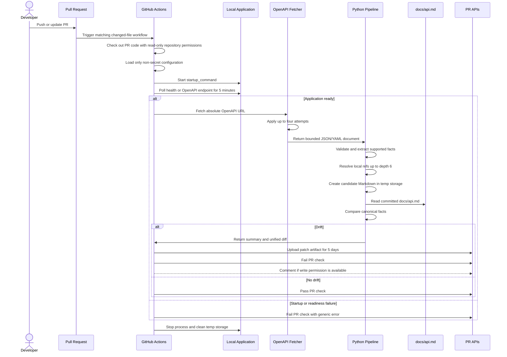

# Architecture: Automated API Documentation Sync

## 1. Purpose

This architecture implements the approved requirements in
[requirements.md](./requirements.md). It provides a pull-request dry-run that
starts a locally running application, reads its live OpenAPI document,
generates a candidate `docs/api.md`, detects API documentation drift, and
reports the result without committing or pushing documentation.

The design prioritizes capstone simplicity and security over enterprise
authentication abstractions.

## 2. Architecture principles

- Execute PR code with read-only repository permissions.
- Never pass secrets to PR code or command-line arguments.
- Do not use `pull_request_target` for untrusted PR execution.
- Keep the initial OpenAPI endpoint unauthenticated and locally reachable.
- Do not implement enterprise authentication unless required configuration and
  provider details are explicitly available.
- Use GitHub Actions and Python; avoid databases, queues, and external services.
- Keep modules small and responsibilities separate.
- Preserve all approved numeric limits and output filenames exactly.
- Never silently replace or expand an approved requirement.

## 3. High-level architecture

```mermaid
flowchart LR
    PR[Pull Request] --> WF[GitHub Actions Workflow]

    subgraph Untrusted Build
        WF --> CFG[Configuration Loader]
        CFG --> LIFE[Application Lifecycle]
        LIFE --> APP[Local Application]
        APP --> OAS[Unauthenticated OpenAPI Endpoint]
        OAS --> FETCH[OpenAPI Fetcher]
        FETCH --> VAL[Validator and Extractor]
        VAL --> REF[Local $ref Resolver]
        REF --> MODEL[Canonical JSON Fact Model]
        MODEL --> MD[Markdown Generator]
        MD --> CAND[Candidate docs/api.md]
        BASE[Committed docs/api.md] --> DRIFT[Semantic Drift Engine]
        CAND --> DRIFT
    end

    DRIFT --> DIFF[Unified Diff and Summary]
    DIFF --> ART[GitHub Artifact]
    DIFF -. available permissions only .-> COMMENT[Conditional PR Comment]
    DRIFT --> CHECK[PR Check Result]
```



GitHub Actions is the workflow coordinator. Python components perform process
startup, OpenAPI fetch and validation, fact extraction, Markdown generation,
and drift detection. The reporting component is isolated from secret-bearing
configuration and raw OpenAPI content.

## 4. Security and trust boundaries

### 4.1 Fork pull requests

The workflow uses the `pull_request` event, never `pull_request_target`.

- A fork pull request does not receive repository secrets.
- The workflow does not grant PR code access to pull-request write permissions.
- Repository secrets and OIDC credentials are excluded from fork and build jobs
  unless GitHub's event model can guarantee a trusted base-branch context.
- An unauthenticated local OpenAPI endpoint is the supported capstone mode.
- If authentication is required but secrets are unavailable, the workflow
  fails clearly; it does not run a guessed token flow.

The PR build job is read-only at the repository boundary. It should set
`contents: read` and not use elevated write permissions. Application startup
must be treated as execution of untrusted pull-request code.

### 4.2 Secrets

- Repository secrets and OIDC values are never passed to `startup_command`.
- Credentials are not included in environment variables exported to all process
  descendants.
- Credentials are not passed through command-line arguments.
- A future credential adapter may keep a value only in HTTP request memory.
- Raw OpenAPI response bodies and authorization headers are not logged.
- Generated Markdown, unified diffs, PR comments, and workflow logs pass a
  redaction and allowlisted-output boundary.

### 4.3 PR reporting

PR comments require `pull-requests: write`. This permission is not guaranteed
for fork pull requests.

The workflow must therefore:

- attempt PR reporting only when comment permissions are available;
- skip or return a generic reporting limitation if commenting is denied;
- always retain the failing check and patch artifact when artifact upload is
  available;
- include only path/schema/missing-fact counts and workflow/artifact links in
  comments;
- never include endpoint payloads, raw specs, authorization values, or startup
  command output in comments.

A reporting step may receive only the sanitized summary and artifact URL. It
must not receive repository secrets or raw OpenAPI response content.

## 5. Component design

### 5.1 GitHub Actions workflow

The workflow is activated for pull requests matching the approved path filters:

- `src/**`
- `app/**`
- `openapi/**`
- `docs/api.md`
- `.github/doc-sync.yml`
- `package.json`
- `pom.xml`
- `requirements.txt`

Responsibilities:

- check out the pull-request branch;
- configure read-only build permissions;
- load non-secret configuration and environment overrides;
- start the application;
- run the Python pipeline;
- upload a unified diff for 5 days;
- fail on drift;
- conditionally add or update one summary-only PR comment.

The workflow never commits or pushes `docs/api.md`.

### 5.2 Configuration loader

The loader reads `.github/doc-sync.yml` and validates:

- required `startup_command`;
- required absolute `openapi_url`;
- required `output_path`;
- optional `health_check_url`;
- optional shell selection;
- optional environment-variable overrides;
- optional authentication mapping.

The initial configuration contract should contain no credential values.

```yaml
startup_command: "application-specific command"
openapi_url: "http://localhost:<port>/openapi.json"
output_path: "docs/api.md"
```

Environment overrides may replace non-secret configuration. Secret mapping is
not required for the initial unauthenticated implementation.

### 5.3 Application lifecycle

The lifecycle component starts `startup_command` with the configured shell and
starts readiness polling.

Readiness:

1. use `health_check_url` when configured;
2. otherwise poll `openapi_url`;
3. stop after the approved 5-minute startup timeout;
4. always terminate the process and clean temporary resources.

The application process is unprivileged and receives no elevated PR write
permission. It may receive only the declared non-secret environment needed by
the application.

Process output is truncated and filtered. The component does not print secret
values or raw endpoint content.

### 5.4 OpenAPI fetcher

The fetcher:

- accepts only absolute HTTP or HTTPS URLs;
- sends `Accept: application/json, application/yaml`;
- allows 180 seconds per request;
- makes four total requests: one initial request and three retries;
- waits one fixed second between attempts;
- accepts JSON and YAML OpenAPI responses;
- rejects documents larger than 10 MB;
- supports an unauthenticated endpoint in the initial implementation.

Enterprise authentication support is required by the approved requirements,
but the provider-specific implementation remains a separate gated boundary:

- Bearer;
- Basic;
- API key;
- OAuth2/OIDC.

No default enterprise adapter is necessary for the local unauthenticated
capstone. If implemented later, credential values must come from a trusted
job context and must not reach PR code or process arguments.

### 5.5 OpenAPI validator and extractor

The validator accepts OpenAPI 3.0 and 3.1 JSON/YAML.

Behavior:

- malformed JSON/YAML or unsafe root structure: fail closed;
- valid operations with invalid individual fields: render affected facts as
  `Not Found`;
- more than 500 paths: fail closed;
- more than 500 schemas: fail closed;
- more than 10 MB: fail closed;
- duplicate tags/IDs: preserve source data and mark ambiguous facts explicitly
  rather than guessing.

The extractor returns:

- path;
- HTTP method;
- parameters;
- headers;
- request body;
- request body schema;
- response status;
- response schema.

Summary and description text are outside the approved documentation field set
and are not included as required output facts.

### 5.6 Local reference resolver

The resolver:

- follows local JSON pointer references only;
- does not fetch external `$ref` URLs;
- marks external references `Not Found`;
- allows no more than 6 resolution levels;
- detects circular references;
- stops before recursive expansion or exponential growth.

### 5.7 Canonical JSON fact model

The canonical model is an internal Python dataclass/dictionary. It represents
supported facts and missing-fact counts. It is used for:

- deterministic Markdown generation;
- semantic drift comparison;
- path and schema counts;
- missing-fact reporting.

No separate JSON repository artifact is required or proposed. `docs/api.md`
remains the only documentation output file.

The model is illustrative:

```json
{
  "paths": [],
  "schemaCount": 0,
  "missingFacts": []
}
```

No JSON schema is committed as an additional artifact.

### 5.8 Markdown generator

The Markdown generator:

- writes `docs/api.md` or the configured `output_path`;
- preserves declared OpenAPI source order;
- documents methods, paths, parameters, headers, request bodies, and responses;
- writes `Not Found` for missing facts;
- escapes Markdown and HTML-sensitive text;
- limits output to 5 MB and 50,000 lines;
- fails if the candidate exceeds either approved limit.

It does not invent a summary, description, example, authentication detail,
schema name, or runtime fact.

### 5.9 Drift engine

The drift engine:

- reads committed `docs/api.md`;
- generates a normalized candidate fact model;
- compares only supported API facts;
- ignores whitespace and formatting-only differences;
- detects endpoint, parameter, header, request-body, response, and schema drift;
- distinguishes changed facts from missing facts;
- produces a unified diff and summary counts.

Missing `docs/api.md` is an explicit failure because an approved baseline is
required. Missing fields within the baseline are compared according to the
same canonical fact representation.

### 5.10 GitHub reporting

The reporting component:

- creates or updates one bot comment when permission is available;
- uses a stable hidden marker to identify its existing comment;
- includes only summary counts, missing-fact counts, and links;
- uploads a unified-diff artifact for 5 days;
- returns a failing check result on drift;
- does not commit or push Markdown.

For fork PRs, if commenting is unavailable, the workflow skips commenting and
retains the failing check plus patch artifact.

## 6. Technology selection

| Technology | Responsibility | Rationale |
|---|---|---|
| Python 3.10+ | CLI, parsing, generation, process control | Existing repository runtime and a small capstone implementation |
| Python standard library | JSON, subprocess, HTTP base utilities, temp files, unittest | Minimizes dependencies |
| `PyYAML` | YAML OpenAPI parsing | Required for JSON and YAML format support |
| `jsonschema` | Structural validation | Avoids bespoke OpenAPI root validation |
| `requests` | HTTP fetch and retry/timeout handling | Simple, mature HTTP API |
| `unittest` | Unit and security tests | Repository convention |
| GitHub Actions | PR trigger, runner, artifact, checks, conditional comments | Approved CI/CD platform |

`jsonschema`, `PyYAML`, and `requests` are implementation dependencies. They
do not introduce a database or external service.

Enterprise SDK or framework authentication libraries are not required for the
initial implementation.

## 7. Runner selection

The approved requirements specify `windows-latest` in FR-5 and the NFR CI
section.

Therefore, the architecture retains `windows-latest` for the implementation
baseline. This document does not silently change the requirement.

An `ubuntu-latest` runner would be simpler for this Python/HTTP workflow and
is more suitable in many cases. It may only replace `windows-latest` after
requirements.md is updated and the PR approval explicitly changes FR-5 and the
NFR CI runner requirement.

The existing unit-test workflow uses `ubuntu-latest` as a Python test matrix,
but that workflow does not establish the API synchronization runner.

## 8. Pull-request data flow



API changes become documentation through this flow:

1. The PR changes application code/configuration.
2. The path filter starts the workflow.
3. The workflow starts the PR application.
4. The live OpenAPI document is fetched.
5. Supported facts are normalized.
6. Candidate `docs/api.md` is generated.
7. Committed `docs/api.md` is compared fact-by-fact.
8. Drift produces a failing check and patch artifact.
9. The developer manually applies the suggested patch.

## 9. Error handling

| Failure | Response | Result |
|---|---|---|
| Application startup failure | Generic lifecycle error and cleanup | Fail |
| Readiness timeout after 5 minutes | Stop process and polling | Fail |
| OpenAPI unavailable | Four attempts exhausted; no raw body output | Fail |
| Authentication unavailable | Explicit configuration/error result | Fail |
| Malformed JSON/YAML | Fail closed | Fail |
| Unsafe root structure | Reject before extraction | Fail |
| Invalid operation field | Mark affected fact `Not Found` | Continue or drift |
| Missing `docs/api.md` | Missing-baseline error | Fail |
| Drift | Summary, unified diff, failing check | Fail |
| External `$ref` | Mark `Not Found`, no network call | Continue or drift |
| Circular or depth-6+ `$ref` | Stop resolution and mark affected fact | Continue or drift |
| Spec exceeds 10 MB | Fail before full parsing | Fail |
| More than 500 paths | Fail closed | Fail |
| More than 500 schemas | Fail closed | Fail |
| Markdown exceeds 5 MB/50,000 lines | Reject candidate | Fail |
| Artifact upload failure | Generic upload error | Fail |
| PR comment denied | Skip comment and retain artifact/check | Pass/fail based on drift |
| Unexpected generation/write failure | Sanitized error and nonzero result | Fail |

## 10. Reproducibility and temp-file safety

- Use a unique temp directory per workflow run.
- Store candidate Markdown, normalized facts, bounded logs, and unified diff
  only in that temp directory.
- Clean temporary content on success and exception paths.
- Do not accept temp paths outside repository/temp boundaries.
- Preserve source order and normalize facts deterministically.
- Ensure identical input/configuration produces identical candidate Markdown.
- Do not include timestamps or runner-specific values in generated Markdown.

## 11. Testing architecture

### 11.1 Mandatory unit tests

`unittest` tests cover:

- configuration loading and environment overrides;
- startup and shell selection;
- OpenAPI 3.0/3.1 JSON/YAML parsing;
- $ref depth, cycles, and external references;
- paths, methods, parameters, headers, request bodies, and responses;
- `Not Found`;
- Markdown generation and escaping;
- 10 MB, 500-path, 500-schema, 5 MB, and 50,000-line limits;
- semantic drift;
- unified diff and summary counts;
- secret redaction.

### 11.2 GitHub Actions smoke test

The workflow smoke test verifies:

- matching PR path filters;
- read-only build permissions;
- no secret exposure to fork PR code;
- Windows runner selection;
- startup and cleanup;
- unauthenticated local OpenAPI fetch;
- drift pass/fail;
- conditional comment behavior;
- patch artifact upload.

### 11.3 Mandatory security tests

- credentials cannot appear in Markdown, logs, comments, or diffs;
- authorization headers and raw response bodies are excluded;
- external $ref resolution performs no network call;
- cyclic/deep $ref resolution terminates;
- temporary files are cleaned;
- fork PR execution has no write permission or repository secret.

Integration and semantic-drift tests are optional unless separately approved.

## 12. Requirement traceability

| Requirement | Architecture component | Trace evidence |
|---|---|---|
| FR-1 | Configuration loader | Reads startup command, absolute URL, and output path |
| FR-2 | Configuration loader | Environment overrides for non-secret values |
| FR-3 | Application lifecycle | Configurable shell |
| FR-4 | GitHub Actions workflow | Approved pull-request path filters |
| FR-5 | Application lifecycle | Start app, 5-minute Windows runner startup |
| FR-6 | Application lifecycle | Health URL or OpenAPI readiness |
| FR-7 | OpenAPI fetcher | Absolute URL only |
| FR-8 | OpenAPI validator | JSON and YAML |
| FR-9 | OpenAPI validator | OpenAPI 3.0/3.1 |
| FR-10 | OpenAPI fetcher authentication boundary | No-auth baseline; four auth modes remain a gated requirement |
| FR-11 | Trusted reporting/config boundary | Secrets/OIDC not exposed to PR code |
| FR-12 | OpenAPI fetcher | 180 seconds, four attempts, fixed 1-second delay |
| FR-13 | Extractor and Markdown generator | Four approved field groups |
| FR-14 | Extractor and renderer | `Not Found` |
| FR-15 | Local ref resolver | Depth 6, local-only, external marked Not Found |
| FR-16 | Validator | Fail closed or mark invalid operation fields |
| FR-17 | Markdown generator | Declared source order |
| FR-18 | Security boundary | No secrets/raw bodies in outputs |
| FR-19 | Drift engine | Committed docs/api.md baseline |
| FR-20 | Drift engine | Semantic fact comparison |
| FR-21 | Workflow/check reporting | Drift fails PR check |
| FR-22 | GitHub reporting | One comment only when permission is available |
| FR-23 | GitHub reporting | Workflow and artifact links |
| FR-24 | Drift reporter | Unified-diff patch |
| FR-25 | Artifact upload | 5-day retention |
| FR-26 | GitHub workflow permissions | Read-only build and conditional reporting |

## 13. Numeric limit verification

| Limit | Source | Handling |
|---|---|---|
| 10 MB raw OpenAPI | requirements.md NFR | Hard fetch/parser limit |
| 500 paths | requirements.md NFR | Reject the 501st path |
| 500 schemas | requirements.md NFR | Reject the 501st schema |
| $ref depth 6 | requirements.md NFR | Maximum resolver depth |
| 5 MB Markdown | requirements.md NFR | Hard renderer limit |
| 50,000 Markdown lines | requirements.md NFR | Hard renderer limit |
| 5-minute startup | requirements.md NFR | Hard readiness deadline |
| 180 seconds/request | requirements.md NFR | Fetch timeout |
| 4 total attempts | requirements.md FR-12 | Initial + three retries |
| 1-second retry delay | requirements.md FR-12 | Fixed delay |
| 5-day artifact retention | requirements.md FR-25 | Artifact action setting |

No proposed engineering default adds a mandatory limit.

## 14. Output verification

The approved repository output is `docs/api.md`. The architecture adds no
committed JSON artifact, additional Markdown document, or Confluence publish
step.

The unified diff is a workflow artifact rather than a repository file. The
workflow may upload a patch and create a conditional PR comment. It never
commits candidate documentation.

## 15. Unresolved requirements and boundaries

1. **Fork PR authentication:** Fork PRs cannot receive repository secrets.
   Authenticated OpenAPI access therefore cannot be guaranteed for fork PRs.
   The initial implementation uses an unauthenticated local endpoint.
2. **Bearer/Basic/API-key/OAuth2 support:** FR-10/FR-11 remain requirements,
   but exact provider and token acquisition behavior is not defined. The
   architecture exposes one future auth boundary and does not invent provider
   details.
3. **Runner conflict:** requirements.md explicitly selects `windows-latest`.
   `ubuntu-latest` is recommended for simplicity only as a future requirements
   clarification; it is not substituted now.
4. **PR comment guarantee:** FR-22 is preserved when permission is available.
   Fork PR restrictions make unconditional commenting impossible.
5. **No hard overall timeout:** No extra job timeout is introduced.
6. **Internal JSON model:** It is not a required output artifact and will not
   be committed.
